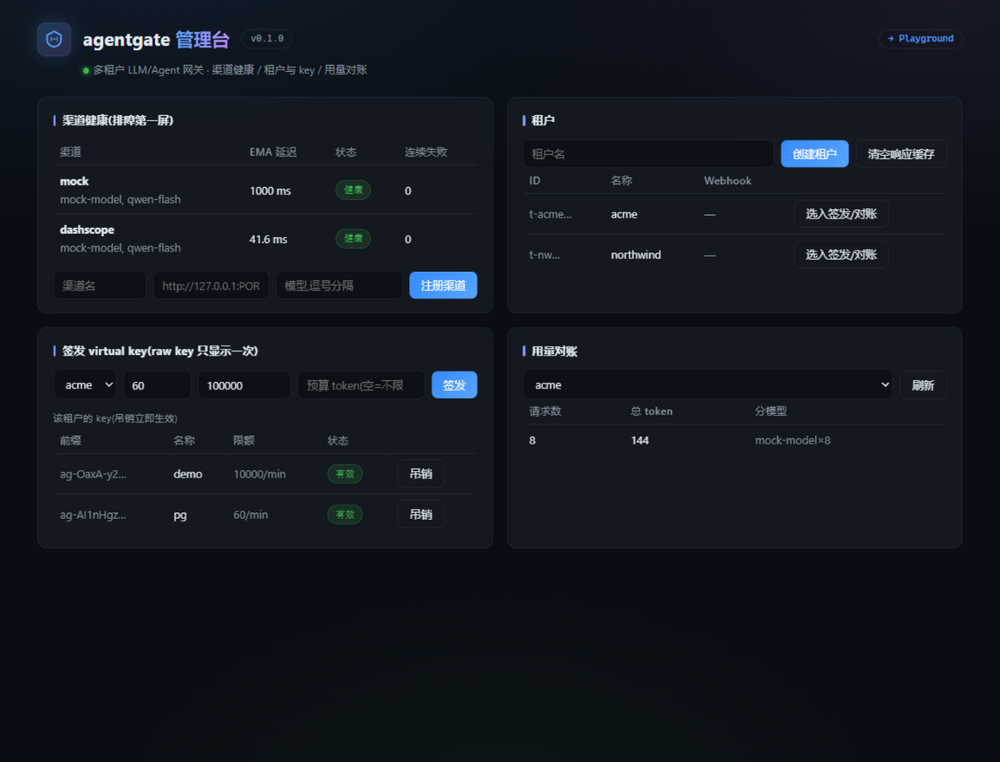
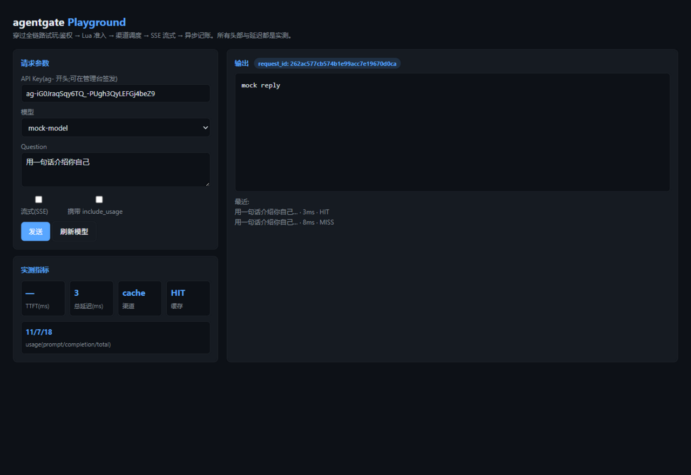

# agentgate · 多租户 LLM/Agent 网关

> 自研 LiteLLM 核心链路:统一鉴权、令牌桶限流、配额计费、SSE 流式代理、故障转移、Streams 异步任务与可观测。
> 定位:简历第三层 —— 检索(PolicyCompass)→ 多 Agent(AskBI)→ **平台化(agentgate)**。
> 设计有据:2026-11 三路实证调研(开源架构 / 30 条 JD 词频 / 面经追问链),每个核心设计标注师承。

## 六个可以对着讲两分钟的硬点

| # | 设计 | 师承(面试可引) | 测试 |
|---|---|---|---|
| 1 | **请求路径零 DB 写**:记账/日志全部后台执行,请求路径只碰 Redis | LiteLLM 架构文档原话 "no database write sits in the request path" | `test_m1_*` |
| 2 | **多副本限流放大坑**:单机内存限流 4 副本=4 倍额度 → Redis+Lua 令牌桶,并发 N 恰好放行容量 N | LiteLLM [redis_requirements](https://docs.litellm.ai/docs/proxy/redis_requirements);APISIX 多实例全局计数是[公认短板](https://github.com/apache/apisix/discussions/13076) | `test_bucket_concurrent_zero_oversell` |
| 3 | **准入单 Lua**:限流桶扣减+TPM 窗口+预算读取一次往返;EVALSHA 化 | Higress [ai-token-ratelimit](https://higress.ai/docs/latest/user/plugins/ai/api-consumer/ai-token-ratelimit) | `test_m1_ratelimit` |
| 4 | **at-least-once + 幂等 = 效果 exactly-once**:Streams consumer group/XACK/XCLAIM 崩溃恢复/死信,幂等键 UNIQUE 兜底 | Dify 用 Celery 是黑盒,ADR-003 自研才讲得透 | `test_m2_streams` |
| 5 | **故障转移状态机**:429 立即冷却+尊重 Retry-After;5xx 冷却 60s;EMA 延迟优先路由;全渠道冷却 → 503(带 Retry-After) | LiteLLM routing/reliability | `test_m2_failover` |
| 6 | **流式 fallback 的语义难题**:chunk 已发出不可回滚 → mid-stream 错误以 SSE error 事件如实透传 | LiteLLM reliability 文档记录的同款 caveat | `test_stream_*` |

## 验收数字(EVIDENCE.md 有完整口径)

- **每请求附加开销 3.70ms**(c=1 无排队口径;<10ms 达标)
- **多进程水平扩展 1.00x → 2.15x → 4.04x**(workers 1/2/4,共享状态全在 Redis)
- **并发 100 限流扣减恰好放行 50**(容量 50,硬上界零超卖)
- **并发 100 记账恰好 1800 token**(原子 INCRBY 零丢失)、账本 100 行对账一致
- **双数据库口径 47+47 全绿**(SQLite + PostgreSQL 16.2 真库,Alembic 迁移真 PG 验证)
- **真实 PolicyCompass 已接入**:OpenAI 请求穿网关→shim→PC CRAG 答题(937ms/710 字),自家网关管自家 Agent



**Playground 试玩台**(`/playground`):贴上 key 即可现场穿过全链路——SSE 逐字输出、
TTFT/总延迟/渠道/缓存命中四指标实测显示、request_id 徽章、历史轨迹(MISS→HIT 一目了然)。



## 快速开始

```bash
# 1) 依赖
python -m venv .venv && .venv/Scripts/pip install -r requirements.txt   # Windows
# 2) Redis(本机无 Docker 时:便携版,或任一 redis-server 于 6379)
# 3) 起服务
set AGENTGATE_UPSTREAM_API_KEY=sk-xxx          # DashScope 或任意 OpenAI 兼容上游
set AGENTGATE_UPSTREAM_BASE_URL=https://dashscope.aliyuncs.com/compatible-mode/v1
uvicorn app.api.main:app --port 8100
# 4) 发 key 并调用
curl -X POST localhost:8100/admin/tenants -d '{"name":"demo"}'
curl -X POST localhost:8100/admin/tenants/<tid>/keys -d '{"rpm_limit":60,"budget_tokens":1000000}'
curl localhost:8100/v1/chat/completions -H "Authorization: Bearer ag-..." \
     -d '{"model":"qwen-turbo","messages":[{"role":"user","content":"你好"}]}'
```

**有 Docker 时**(生产拓扑,含 PG16/Redis7-AOF/Prometheus/Grafana):

```bash
cd deploy && docker compose up -d   # gateway:8100 · prometheus:9090 · grafana:3300
```

## 压测

```bash
python scripts/load_test.py --requests 2000 --concurrency 50 --out evidence/load_report.md
```

方法论:客户端瓶颈会冒充服务端瓶颈 —— 用 aiohttp(C 解析器),服务端数字取同客户端同并发差值;
每请求开销在 c=1 无排队条件下测,c=N 测的是容量与排队。绝对吞吐受单进程 GIL 约束,
生产 `uvicorn --workers N` 水平扩展(与 LiteLLM 部署形态一致)。

## 诚实的边界(面试主动讲,反而是加分)

- **语言选型**:Python 单实例千级 RPS 是公开事实;本项目是 IO 密集网关,瓶颈在上游模型秒级延迟,
  LiteLLM 同架构 1k RPS 下 P95=8ms 且被 Stripe/Netflix 生产采用;超热点路径的下沉触发条件
  (Rust/Go 核心)写在 [ADR-001](docs/adr/ADR-001-why-python.md)。
- **TPM 是固定 60s 窗口**:窗口交界可能放过 ~2×;滑动窗口/令牌桶化在 backlog(EVIDENCE §边界)。
- **预算是计量制**:扣减在响应后(真实 token 数),在途并发最多超出"在途请求数×单请求 token";
  限流桶才是硬上界 —— 两者分开表述,不混淆承诺。
- **本机开发用 SQLite + 便携 Redis**:代码方言中立(SQLAlchemy 通用类型),生产 compose 走
  PostgreSQL + Redis7-AOF;SQLite 与 PG 口径分列,PG 数字待 Docker 就绪复跑(ADR-002)。
- Redis 5.0 便携版无 XAUTOCLAIM(6.2+):崩溃恢复用 XPENDING+XCLAIM 实现,兼容两者(ADR-003)。

## 结构

```
app/
  api/        v1_chat(协议+调度+记账+缓存) · admin(租户/key/渠道/用量/缓存) · main(工厂+管理台)
  auth/       virtual key 缓存优先鉴权(哈希存储,raw key 只见一次)
  ratelimit/  Lua 令牌桶 · 准入单脚本(EVALSHA) · 令牌桶独立 consume
  quota/      预算/TPM 窗口 · 单写者异步记账(请求路径零 DB 写)· 账本重建
  router/     渠道注册表 + 冷却/EMA 状态机(Redis 状态,多副本一致)
  queue/      Redis Streams 任务队列(group/ack/XCLAIM/DLQ)+ webhook 投递器
  cache/      精确响应缓存(租户隔离键 · 确定性门控 · TTL 惰性失效)
  upstream/   httpx 客户端(trust_env=False)+ SSE 旁观解析(TTFT/usage)
  observability/  Prometheus 指标(TTFT/token/缓存命中/队列深度)
  mcp_server.py   MCP stdio 工具面(渠道健康/用量/预算/签发 key,与网关共享状态)
  web/        管理台单文件页(/admin/web)
  db/         SQLAlchemy 2.0 方言中立模型 + Alembic
docs/adr/     ADR-001 语言选型 · ADR-002 存储策略(双口径) · ADR-003 Streams vs Celery
docs/PROJECT_BOOK.md  面试深挖手册(10 问三段式 + 诚实边界 + 演示剧本)
tests/        47 项(mock 故障注入/真 TCP/真 Redis 集成/MCP 握手/缓存/双数据库)
scripts/      load_test(附加开销口径)· load_workers(扩展曲线)· demo_admin · demo_ecosystem · demo_pc_gateway · smoke_real · verify_pg_migration · agent_shim_example
deploy/       docker-compose(生产拓扑)
PRODUCTION_GAP.md  上线前差距清单(A 必做/B 应做/C 锦上添花,同 askbi/PC 纪律)
```
